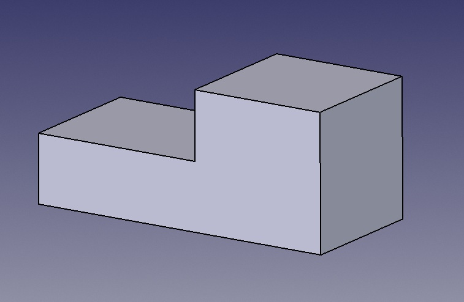
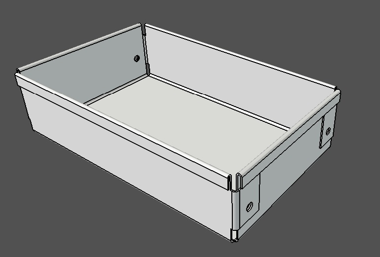
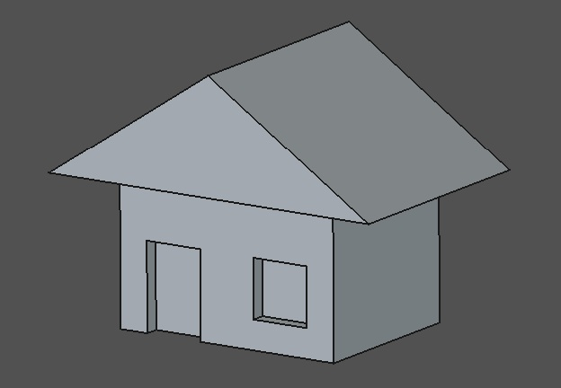
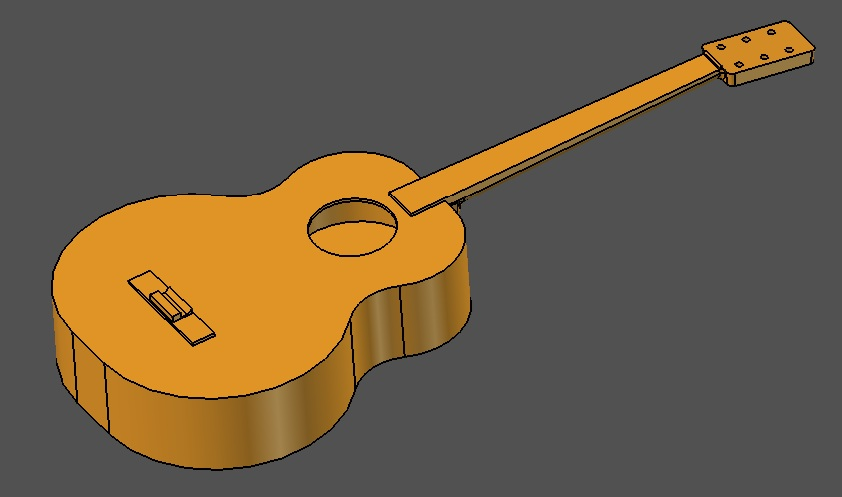

# Ingko's FreeCAD Files

A free collection of 3D models, parts, and tutorial projects created in [FreeCAD](https://freecad.org).

## Tutorial Files

| File Name | Description | Preview |
| :--- | :--- | :--- |
| [Sample01.FCStd](Tutorial_Files/Sample01.FCStd) | First sample FreeCAD tutorial part |  
[TMNT.FCStd](Tutorial_Files/TMNT.FCStd) | Parametric turtle character head| 
[SheetMetalBox.FCStd](Tutorial_Files/SheetMetalBox.FCStd) | Sheet metal workbench box| 
[SimpleHouse.FCStd](Tutorial_Files/SimpleHouse.FCStd) | A simple house| 
[Guitar.FCStd](Tutorial_Files/SheetMetalBox.FCStd) | Parametric guitat| |

## How to Use

1. Click any **Download (.FCStd)** link above to save the model to your computer.
2. Open the file using **FreeCAD** (v0.21 or v1.0+ recommended) to inspect the feature tree, edit dimensions, or export to `.STL` / `.STEP` for 3D printing.

## License

**[License: CC BY-NC 4.0 International](https://creativecommons.org)**

Copyright (c) 2026 IngkoM3

The FreeCAD files and 3D models in this repository are licensed under a [Creative Commons Attribution-NonCommercial 4.0 International License](https://creativecommons.org).

* **You are free to:** Download, print, and modify these files for personal, educational, or non-commercial use, provided you give proper credit.
* **You may not:** Sell the digital files or any physical items produced from these designs.
